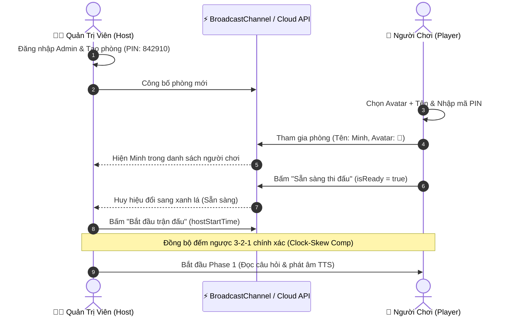

# 🏆 Đấu Trường Hanyu (Hanyu Arena) — Tài Liệu Kiến Trúc & Hướng Dẫn Vận Hành

> **Hanyu Arena** là chế độ thi đấu đối kháng từ vựng tiếng Trung thời gian thực lấy cảm hứng từ Kahoot, được xây dựng theo kiến trúc **5-Phase Lifecycle** hiện đại, hỗ trợ cả màn hình Host/Admin trình chiếu và thiết bị di động của Người chơi.

---

## 📌 1. Tổng quan tính năng

- **Đối kháng từ vựng theo thời gian thực:** Người chơi thi đấu theo vòng câu hỏi, chọn 1 trong 4 đáp án màu sắc (Đỏ, Xanh dương, Vàng, Xanh lá).
- **Hệ thống tính điểm thông minh:** Điểm số tính theo độ chính xác, tốc độ trả lời (tối đa 1000 điểm/câu) và hệ số nhân chuỗi thắng liên tiếp (Streak Bonus).
- **Âm thanh Web Audio sống động:** Tích hợp hiệu ứng âm thanh Synthesizer (Tick đếm ngược, Tiếng chọn đáp án, Fanfare chiến thắng, Thông báo đúng/sai) không cần tải file mp3 bên ngoài.
- **Tự động hóa hoàn toàn (Autonomous Mode):** Trận đấu tự động chuyển pha, đếm ngược và sang câu hỏi tiếp theo mà không bắt buộc Admin phải bấm chuột thủ công.
- **Chế độ Luyện tập Đơn (Solo Play) cho phòng công khai:** Người chơi có thể tự trải nghiệm thi đấu ngay lập tức trên máy mình mà không cần chờ Admin bắt đầu.

---

## 🏠 2. Các Chế Độ Phòng Đấu

Hệ thống hỗ trợ 2 loại phòng thi đấu:

### 2.1. Phòng Công khai (Public Room)
- **Mục đích:** Dành cho việc tự học, thi đấu mở hoặc sự kiện cộng đồng.
- **Đặc điểm:**
  - Tự động xuất hiện trong danh sách **"Phòng thi đấu công khai"** ở màn hình sảnh chờ của người chơi.
  - Người chơi có thể xem trước số người tham gia, chủ đề HSK và thời gian còn lại của phòng.
  - **Tự do thi đấu:** Người chơi có thể bấm **"Bắt đầu thi đấu ngay ➔"** để tự giải bộ câu hỏi của phòng (chế độ Solo Play) với bộ đếm tự động 2.5 giây giữa các câu, điểm số được ghi nhận trực tiếp vào Bảng xếp hạng chung của phòng.

### 2.2. Phòng Riêng tư (Private Room)
- **Mục đích:** Dành cho lớp học, nhóm bạn hoặc các kỳ thi nội bộ có quản trò.
- **Đặc điểm:**
  - Được bảo vệ bằng **Mã PIN ngẫu nhiên 6 chữ số** (ví dụ: `842910`) hoặc **Mã QR / Đường link mời trực tiếp**.
  - **Kiểm tra tính hợp lệ nghiêm ngặt:** Hệ thống xác minh mã PIN trên bộ nhớ/Cloud trước khi cho phép vào. Nếu người chơi nhập bừa mã không tồn tại, hệ thống lập tức thông báo lỗi cụ thể và từ chối điều hướng, ngăn chặn việc vào các phòng "ma".

---

## 👥 3. Cơ Chế Quản Trị Viên (Host) & Người Chơi (Player)



### 3.1. Phân quyền Quản trị viên (Admin Host)
- **Đăng nhập:** Người dùng đăng nhập quyền Admin thông qua nút Hồ sơ trên Header (`#btnProfile`). Khi đã xác thực quyền Admin, giao diện Arena tự động kích hoạt tab **"Bảng điều khiển phòng đấu"**.
- **Quyền hạn của Admin:**
  - Chọn chủ đề câu hỏi (HSK 1 đến HSK 6, hoặc Bộ từ tự tạo Custom Deck).
  - Chọn kiểu câu hỏi: *Hán tự ➔ Nghĩa*, *Nghĩa ➔ Hán tự*, *Hán tự ➔ Pinyin*, hoặc *Hỗn hợp ngẫu nhiên*.
  - Điều chỉnh số lượng câu hỏi (5, 10, 15, 20 câu) và thời gian trả lời mỗi câu (10s, 15s, 20s, 30s).
  - Chọn chế độ Công khai hoặc Riêng tư (cần mã PIN).
  - Thêm Bot ảo thử nghiệm để test tính năng phòng thi đấu.
  - Tạm dừng, xem lại danh sách phòng đã lưu hoặc xóa phòng.

### 3.2. Cơ chế Người chơi (Player)
- **Định danh nhanh:** Người chơi chọn biểu tượng Avatar ngộ nghĩnh (🐼, 🦊, 🐯, 🐉, 🐱, 🐰, 🦁, 🐻, 🐸, 🦄) và nhập Biệt danh.
- **Nút "Sẵn sàng thi đấu":** Khi vào phòng, người chơi bấm nút **"Sẵn sàng thi đấu"**. Trạng thái được đồng bộ ngay tức thì lên màn hình Host.
- **Bắt đầu trận đấu & Đồng bộ đếm ngược 3-2-1:**
  - Host quan sát danh sách người chơi đã sẵn sàng và bấm nút **"Bắt đầu trận đấu"**.
  - Host gửi tín hiệu mốc thời gian bắt đầu kèm độ bù lệch đồng hồ mạng (`clockSkewCompensation`). Cả màn hình Host và tất cả điện thoại Người chơi đếm lùi `3... 2... 1...` hoàn toàn đồng bộ trước khi hiện câu đầu tiên.

---

## 🔄 4. Chu Trình 5 Phase Câu Hỏi Tự Động (5-Phase Lifecycle)

Hệ thống hoạt động theo chu kỳ 5 pha chuẩn mực không cần thao tác bấm chuyển câu thủ công:

| Phase | Tên Pha | Thời Gian | Mô Tả Màn Hình Host | Mô Tả Màn Hình Player |
| :---: | :--- | :---: | :--- | :--- |
| **1** | **Get Ready** | 3 giây | Hiện câu hỏi chữ Hán cỡ lớn, Pinyin, nghĩa gợi ý và phát âm TTS. 4 ô đáp án bị ẩn. | Hiện vòng xoay đếm ngược 3 giây và chữ Hán cần nhận diện. |
| **2** | **Answering** | 10–30 giây | 4 ô đáp án A/B/C/D bật mở rực rỡ, đồng hồ đếm ngược chạy. | 4 bàn phím màu sắc hiển thị. Chạm để nộp bài ngay. |
| **3** | **Lock & Cut-off** | Tức thì | Đếm số lượng người đã nộp bài. Nếu **100% người chơi đã nộp bài**, hệ thống tự ngắt giờ sớm để không phải chờ hết giờ vô ích. | Khóa thao tác bấm, hiện trạng thái *"Đã ghi nhận bài nộp, đang chờ người chơi khác..."*. |
| **4** | **Reveal & Stats** | 4 giây | Bật sáng đáp án đúng, hiện biểu đồ thống kê số người chọn từng đáp án A/B/C/D. | Đổi màu toàn màn hình: **Xanh lục** (Chính xác kèm số điểm cộng) hoặc **Đỏ** (Sai kèm đáp án đúng). |
| **5** | **Leaderboard** | 4 giây | Hiện Bảng xếp hạng điểm số đầy đủ kèm chuỗi thắng của các đấu thủ. Tự động đếm lùi sang câu tiếp theo. | Hiện thứ hạng cá nhân hiện tại, số điểm đang có và khoảng cách điểm so với người xếp ngay trên. |

---

## 🎯 5. Cơ Chế Chống Trùng Lặp Điểm (Unique Player per Room)

Một vấn đề phổ biến ở các nền tảng thi đấu là khi người chơi rớt mạng hoặc tải lại trang, họ thường bị tính thành một người chơi mới với 0 điểm, tạo ra 2 dòng trùng tên trong bảng xếp hạng.

Hanyu Arena đã giải quyết triệt để vấn đề này:
1. **Ràng buộc duy nhất:** Mỗi biệt danh (Nickname) trong một phòng chỉ có duy nhất **1 bản ghi người chơi** trên bảng xếp hạng.
2. **Bảo lưu & Cập nhật kỷ lục:** Khi một người chơi vào lại phòng với cùng tên đã dùng trước đó:
   - Hệ thống tự động nhận diện người chơi cũ.
   - Điểm số của lượt thi đấu mới sẽ được **so sánh và giữ mốc điểm cao nhất** (`Math.max(oldScore, newScore)`), không tạo thêm dòng mới.
3. **Bảng xếp hạng đầy đủ:** Hiển thị toàn bộ người chơi tham gia trong phòng (thay vì cắt ngọn Top 5), giúp tất cả mọi người đều theo dõi được vị trí của mình.

---

## 🎨 6. Thiết Kế Giao Diện & Tiêu Chuẩn Tương Phản (High-Contrast)

Giao diện được thiết kế theo phong cách tối giản cao cấp (Modern Minimalist Chinese Style), tuân thủ nghiêm ngặt chuẩn tương phản tiếp cận **WCAG AA**:

```text
Light Theme (Nền kem sáng #f8f6f0):
  ├── Nút hành động chính: Nền Đỏ cam (#c0392b) ➔ Chữ Trắng (#ffffff) — Tương phản > 4.6:1
  ├── Nút vô hiệu hóa (:disabled): Nền be (#ece7dc) ➔ Chữ xám mờ (#78716c)
  ├── Huy hiệu Sẵn sàng / Kết nối: Chữ Xanh rừng thẫm (#166534) trên nền xanh pastel — Tương phản > 5.5:1
  ├── Huy hiệu Riêng tư / Hạn chót: Chữ Nâu hổ phách (#b45309) trên nền hổ phách pastel — Tương phản > 4.8:1
  └── Ô đáp án Vàng Kahoot: Nền Vàng đất đậm (#945610) ➔ Chữ Trắng (#ffffff) — Tương phản > 5.1:1

Dark Theme (Nền than đậm #141312):
  ├── Nút hành động chính: Nền Đỏ rực (#c0392b) ➔ Chữ Trắng (#ffffff)
  ├── Huy hiệu Sẵn sàng: Chữ Xanh ngọc lục bảo (#34d399) phát sáng dịu
  ├── Huy hiệu Riêng tư: Chữ Vàng hổ phách (#fbbf24)
  └── Thông báo kết quả Đúng: Chữ Xanh ngọc (#34d399) nổi bật trên thẻ nền đen
```

---

## 🛠️ 7. Cấu Trúc Kỹ Thuật & Khóa Lưu Trữ

### 7.1. File mã nguồn
- `pages/arena.html`: Cấu trúc DOM hoàn chỉnh (Giao diện Host, Giao diện Player, Modal kết quả, Modal đăng nhập Admin).
- `js/arena.js`: Toàn bộ Game Engine, Web Audio SFX, State Machine, đồng bộ BroadcastChannel và LocalStorage.
- `styles.css`: Bộ quy tắc định dạng giao diện Arena, Grid 4 màu Kahoot, animation đếm ngược và responsive trên màn hình điện thoại.

### 7.2. Khóa `localStorage` sử dụng
| Key | Ý nghĩa |
| :--- | :--- |
| `WQ_ARENA_HOST_ROOMS` | Danh sách metadata các phòng do Host quản lý (`[{ pin, title, mode, qCount, access, ... }]`) |
| `WQ_ARENA_ROOM_<PIN>` | Trạng thái chi tiết của phòng đấu: danh sách câu hỏi, pha hiện tại, bảng điểm người chơi |
| `WQ_ARENA_PLAYER_PROFILE` | Thông tin hồ sơ tạm của người chơi (`{ name, avatar }`) |
| `WQ_ARENA_ADMIN_AUTH` | Token xác thực quyền Admin (`{ isAdmin: true, loginAt: ... }`) |

### 7.3. Đồng bộ Thời gian thực (Real-time Architecture)
- **Primary:** Cloudflare Workers Durable Objects (`ArenaRoom`) qua giao thức WebSocket hai chiều (`wss://hanyu.phuonganhkhanh683.workers.dev/parties/main/:pin`), độ trễ <20ms, 0 HTTP request, 0 D1 quota.
- **Fallback:** Cloudflare Edge Cache (`caches.default`) + Smart HTTP Polling (`/api/arena/sync`) chu kỳ 1.000ms khi mất kết nối mạng.

---

*Tài liệu được cập nhật tự động cùng phiên bản hệ thống Hanyu v37.*
