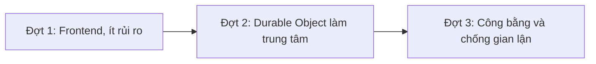
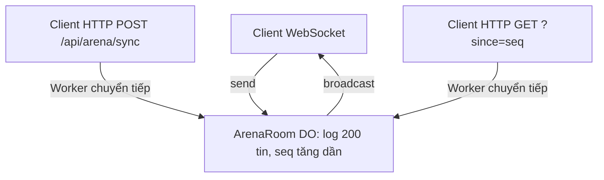

# Kế hoạch sửa logic Arena

Chia làm 3 đợt. Đợt sau dựa vào đợt trước. Đợt 1 chỉ sửa frontend, không phải deploy Worker.



---

## Đợt 1: Sửa nhanh ở frontend (chỉ `js/arena.js`)

### 1.1 Thoát game solo bị kéo vào lại
Trong [playerLeaveRoom](file:///c:/Users/vknguyen/hanyu/js/arena.js#L1327), thêm đoạn dọn timer solo:
```js
['soloAutoAdvanceTimer','soloPhaseTimer','soloTimeoutTimer'].forEach(function (k) {
  if (gameState[k]) { clearTimeout(gameState[k]); clearInterval(gameState[k]); gameState[k] = null; }
});
gameState.isSoloRunner = false;
```

### 1.2 Phòng đã đóng vẫn vào được
- Trong [fetchPublicRooms](file:///c:/Users/vknguyen/hanyu/js/arena.js#L2011): nếu cloud trả về thành công thì **chỉ dùng danh sách của cloud**, bỏ hẳn bước gộp với cache trong máy (dòng 2039–2046). Cache trong máy chỉ dùng khi mất mạng.
- Trong `verifyRoomExists`: bỏ nhánh 3A/3B. Hai nhánh này cho vào phòng chỉ vì máy có cache. Chỉ cho vào khi cloud xác nhận phòng còn và chưa hết hạn.
- Khi đóng phòng: gọi thêm `DELETE /api/arena/rooms/:pin`. Route này backend đã có ở dòng 536.
- Mở phòng từ URL (`restorePlayerSessionByPin`): kiểm tra `verifyRoomExists` trước, không có phòng thì xóa session và về màn hình nhập mã.

### 1.3 Mất kết nối thì tin nhắn cũ bị phát lại
- `startCloudPolling` **giữ lại `_lastSyncMsgId`** giữa các lần kết nối lại, không đặt về 0 nữa.
- Nếu chưa có id nào, ví dụ vừa F5: lần poll đầu chỉ **lấy id mới nhất**, không xử lý tin nào. Trạng thái hiện tại để chủ phòng gửi lại qua `lobby_roster_sync` / `phase_*`.
- Chỉ tính chênh lệch đồng hồ từ tin `phase_*` của chủ phòng có `timestamp` trong vòng 10 giây gần nhất.

### 1.4 Kết nối lại có backoff, gửi nốt hàng đợi
- Kết nối lại theo mốc 1s → 2s → 4s → … tối đa 30s. Kết nối được thì đặt lại về 1s.
- `onerror` và `onclose` gộp vào một hàm, tránh chạy polling 2 lần.
- `disconnectPartyKit` không xóa `_wsSendQueue` nữa. Tin còn trong hàng đợi thì gửi qua HTTP.
- `_processedMsgIds`: chỉ giữ khoảng 500 id gần nhất (xóa id cũ theo FIFO).

### 1.5 Bớt request thừa
- `publishPublicRoom` chỉ gọi khi **tạo phòng, đổi trạng thái** (lobby → đang chơi → kết thúc) hoặc **số người thay đổi**. Thêm throttle 5 giây.
- Bỏ lần gọi `broadcastLobbyRoster` bị lặp trong handler `player_join` (dòng ~4659).

---

## Đợt 2: Durable Object làm trung tâm của phòng (backend + frontend)

Gốc của lỗi "người dùng WebSocket và người dùng HTTP không thấy nhau" là server chỉ chuyển tin giữa các socket, không lưu gì. Hướng sửa là để **mỗi phòng = 1 Durable Object giữ toàn bộ tin nhắn**, còn HTTP và WebSocket chỉ là hai cách khác nhau để đọc và ghi vào đó.



Thay đổi trong [index.js](file:///c:/Users/vknguyen/hanyu/backend/src/index.js):
- `ArenaRoom` lưu `log` (200 tin gần nhất) và `seq` vào `this.state.storage`. Mỗi tin nhận được thì gắn `seq` tăng dần, rồi broadcast `{seq, msg}`.
- Thêm route trong DO: `POST /push` (HTTP gửi tin, DO cũng broadcast ra các socket), `GET /since?seq=N` (HTTP đọc tin), `DELETE /` (xóa phòng).
- Worker `/api/arena/sync` bỏ RAM, Edge Cache và D1, chuyển tiếp thẳng vào DO của PIN đó. **Từ đây chỉ còn một nguồn id**, hết lỗi trộn id.
- Khi socket mới kết nối: DO gửi ngay các tin từ `?since=` mà client đưa lên. Vì vậy F5 hay kết nối lại đều không mất tin, cũng không bị phát lại tin cũ.
- Dùng `storage.setAlarm()` để tự xóa phòng sau `expiresAt` hoặc sau 2 giờ không hoạt động. Dọn phòng không còn phụ thuộc vào máy của chủ phòng.

> [!NOTE]
> Durable Object có sẵn storage nên không tốn quota D1. Gói free của Cloudflare dùng được Durable Object loại SQLite (wrangler.toml đã khai báo `new_sqlite_classes`).

---

## Đợt 3: Công bằng và chống gian lận

### 3.1 Phân biệt chủ phòng
- Khi tạo phòng, DO sinh một `hostToken`. Chỉ máy chủ phòng giữ token này (localStorage).
- Socket kết nối với `?role=host&token=...` thì được đánh dấu là host (`ws.serializeAttachment({role:'host'})`).
- DO **bỏ** tin `phase_*`, `game_over`, `player_kick`, `lobby_roster_sync` nếu người gửi không phải host.

### 3.2 Điểm do chủ phòng tính
- Chủ phòng **bỏ qua `score` mà người chơi gửi lên** trong `player_join` / `lobby_roster_sync`. Điểm chỉ được cộng khi chủ phòng tự chấm `player_answer`.
- Khi người chơi vào lại: chủ phòng tìm theo `id` và giữ điểm đang lưu.
- Chế độ solo công khai: không có chủ phòng chấm, nên điểm chỉ để xem trong máy. Bảng xếp hạng ghi rõ "tự chấm". Nếu muốn chống gian lận đầy đủ thì phải để DO chấm (giữ đáp án trong DO), nhưng việc này làm lâu hơn.

### 3.3 Đáp án gắn với câu hỏi
- `player_answer` gửi kèm `questionIndex`.
- Chủ phòng chỉ chấm khi `questionIndex === currentQuestionIndex`, `now <= questionEndTime + 500ms` và người đó **chưa trả lời câu này** (dùng `Set` theo từng câu).
- Máy người chơi khóa nút khi hết giờ.

### 3.4 Kết nối lại không mở khóa đáp án của người khác
- Khi có người vào lại giữa câu, chủ phòng **chỉ gửi cho người đó** (`targetId`) một tin `phase_2_active` có `restore: true`.
- Máy người chơi: nếu `restore` và cùng `questionIndex` thì giữ nguyên `playerLastChoice`.

### 3.5 Trùng tên, kick, thoát phòng
- Gộp người chơi **chỉ theo `id`**. Nếu tên đã có người khác dùng thì chủ phòng trả `join_rejected {reason:'name_taken'}` và máy người chơi yêu cầu đổi tên.
- Thêm tin `player_leave` (người chơi gửi khi bấm thoát) và `player_kick {id}` (chủ phòng gửi). Người bị kick thì xóa session, về màn hình nhập mã và bị chặn vào lại phòng đó.
- Người đã thoát không được tính vào điều kiện "mọi người đã trả lời", để vòng chơi kết thúc sớm như bình thường.

### 3.6 Lặt vặt
- Bằng điểm thì đồng hạng (1, 1, 3).
- Bỏ con số 850 điểm giả; nếu không có dữ liệu thì hiện "—".

---

## Ước lượng và thứ tự đề xuất

| Đợt | Phạm vi | Rủi ro | Deploy Worker |
|---|---|---|---|
| 1 | ~150 dòng trong `arena.js` | Thấp | Không |
| 2 | Viết lại `ArenaRoom` + route sync (~200 dòng), sửa polling ở client | Trung bình | Có (`wrangler deploy`) |
| 3 | Giao thức tin nhắn + logic chủ phòng (~250 dòng) | Trung bình | Có |

> [!IMPORTANT]
> Đợt 2 đổi định dạng tin nhắn (`{seq, msg}`), nên **frontend và Worker phải deploy cùng lúc**. Máy nào còn cache bản JS cũ trong Service Worker (`sw.js`) cần tăng version cache.
